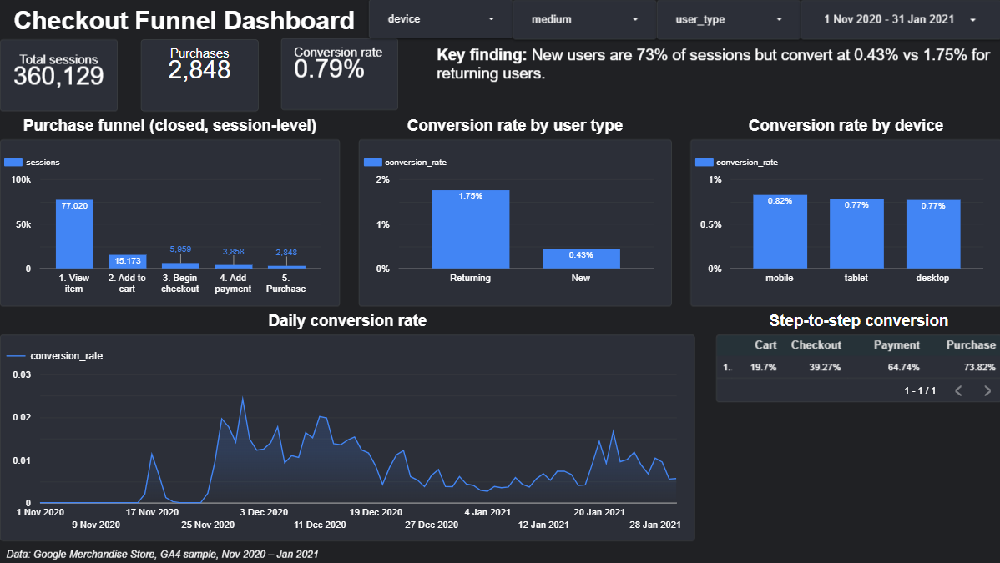

# Checkout Funnel & Drop-off Analysis (GA4, BigQuery)

**Live dashboard:** https://datastudio.google.com/reporting/9a2b49e0-c543-407f-b0ed-38bfbae61a91

## Question
Where do Google Merchandise Store visitors drop out of the purchase journey,
which user groups underperform, and what should we test first?

## Data
Google Analytics 4 obfuscated sample (bigquery-public-data), 1 Nov 2020 to 31 Jan 2021:
4295584 events, 270154 users, 360,129 sessions.
This is a holiday-heavy period (Black Friday to Christmas), so conversion rates may differ from a typical quarter.

## Method
1. SQL: collapsed raw events into sessions (CTEs, UNNEST on nested event_params)
2. Built a 5-stage closed funnel: view_item, add_to_cart, begin_checkout, add_payment_info, purchase
3. Segmented by device, acquisition medium, and new vs returning users
4. Sized the opportunity and ran a power analysis for proposed tests
5. Built a Looker Studio dashboard with filters and a daily conversion trend

## Funnel
| Stage | Sessions | Step conversion |
|---|---|---|
| View item | 77,020 | - |
| Add to cart | 15,173 | 19.7% |
| Begin checkout | 5,959 | 39.3% |
| Add payment info | 3,858 | 64.7% |
| Purchase | 2,848 | 73.8% |

Overall session conversion is 0.79% (2,848 of 360,129 sessions). Only 21% of sessions viewed a product;
among sessions that did, 3.7% ended in a purchase.

## Segments
| Segment | Sessions | Conversion | Checkout to payment |
|---|---|---|---|
| New users | 261,238 | 0.43% | 48.4% |
| Returning users | 98,891 | 1.75% | 83.4% |
| Desktop | 208,942 | 0.77% | 64.1% |
| Mobile | 143,185 | 0.82% | 65.5% |
| Tablet | 8,002 | 0.77% | 67.7% |

## Key findings
- Largest drop-off: view item to add to cart (19.7% of sessions continue)
- New users are 73% of sessions but convert at 0.43%, versus 1.75% for returning users
- Among new users who begin checkout, only 48.4% add payment info (returning users: 83.4%)
- Device makes little difference (0.77% to 0.82%)
- Closing the new-user gap to the 0.79% site average is worth about 313 extra orders per month (upper-end estimate)

## Recommended experiments
Both target new users at checkout. Power analysis (10% relative lift, alpha 0.05, power 0.8) needs
837 sessions per group, about 7 weeks at current traffic. See [experiment_design.md](experiment_design.md).

## Data-quality notes
- Daily conversion is zero for the first part of November 2020 in the dashboard trend. [ADD WHAT YOU FOUND AFTER RUNNING THE DAILY CHECK QUERY]
- Medium values `<Other>` and `(data deleted)` come from Google's obfuscation, so no conclusions are drawn from them
- The funnel is closed: a session counts at a stage only if it also completed every earlier stage

## Limitations
- Holiday-heavy period
- The opportunity estimate assumes new users can reach the site average, which is optimistic
- Device, medium, and user type are separate cuts of the same sessions, so their opportunities can't be added together

## Tools
BigQuery SQL, Python (statsmodels), Google Sheets, Looker Studio